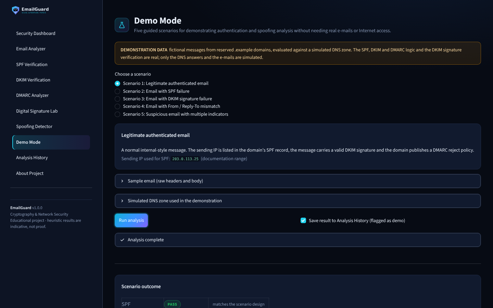
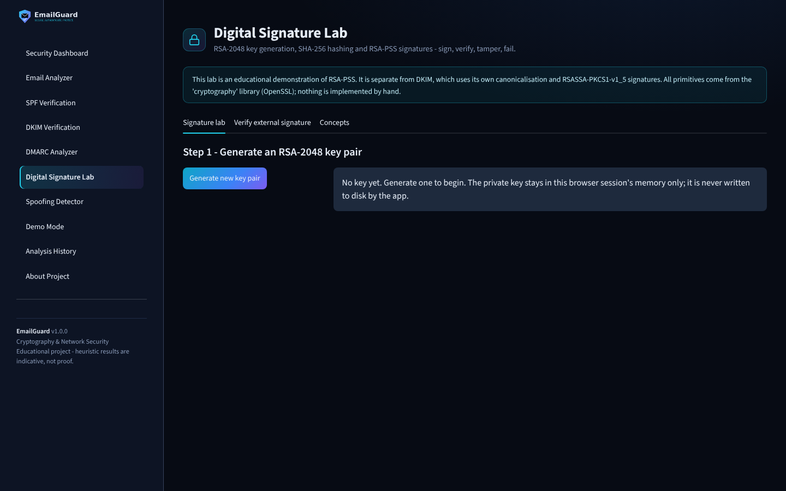

# EmailGuard

**Intelligent Email Authentication and Spoofing Detection System Using Cryptographic Techniques**

*Secure. Authenticate. Protect.*

A Cryptography and Network Security (CNS) mini-project. EmailGuard is a Streamlit application that parses
e-mails, evaluates SPF / DKIM / DMARC, scores spoofing indicators, demonstrates RSA-2048 / SHA-256 / RSA-PSS
digital signatures, stores every analysis in SQLite and exports PDF reports.

> **Honesty principle.** Every result states *how* it was produced: `CRYPTOGRAPHIC` (a signature was really
> verified), `DNS` (a record was fetched and evaluated), `HEADER CLAIM` (the message says so - **not** verified),
> `HEURISTIC` (rule-based) or `DEMONSTRATION` (simulated). If information is missing, the result is
> **NOT EVALUATED** - EmailGuard never reports a pass it could not establish.

---

## 1. Features

| Page | What it does |
|---|---|
| **Security Dashboard** | KPIs, activity chart, results donut, SPF/DKIM/DMARC outcome chart, threat distribution, recent history, alerts. All numbers come from SQLite. |
| **Email Analyzer** | Paste headers / full message, upload `.eml`, or enter sender details. Extracts From, To, Reply-To, Return-Path, Subject, Date, Message-ID, Received, Authentication-Results, DKIM-Signature. Runs SPF, DKIM, DMARC and the spoofing rules; detailed report and PDF. |
| **SPF Verification** | Real DNS lookup (dnspython), mechanism parser, IP evaluation, PASS / FAIL / SOFTFAIL / NEUTRAL / NONE / PERMERROR / TEMPERROR, evaluation trace. |
| **DKIM Verification** | Real verification with the maintained `dkimpy` library; key fetched from DNS; failure explanations. Separate, labelled educational demo that signs and tampers with a message. |
| **DMARC Analyzer** | `_dmarc` TXT lookup, tag table (v, p, sp, rua, ruf, pct, adkim, aspf), policy explanation, alignment evaluation that stays *NOT EVALUATED* without real SPF/DKIM outcomes. |
| **Digital Signature Lab** | RSA-2048 key generation, SHA-256, RSA-PSS sign/verify, tamper-and-fail demo, avalanche-effect meter, key download (private key can be passphrase-encrypted), external signature verifier, concept comparisons. |
| **Spoofing Detector** | 0-100 heuristic risk score (LOW 0-29, MEDIUM 30-59, HIGH 60-100) with every contributing indicator explained. |
| **Demo Mode** | Five scenarios (legitimate, SPF failure, DKIM failure, Reply-To mismatch, multi-indicator phishing) run through the real engine against a simulated DNS zone, labelled **DEMONSTRATION DATA**. Works offline. |
| **Analysis History** | Search, filter, sort, detail view, CSV export, delete (selected / demo / real / all). |
| **About Project** | Description, problem statement, objectives, technologies, CNS syllabus mapping, editable developer placeholders. |

## 2. Technologies

Python 3.11+, Streamlit, custom CSS, Plotly, SQLite (`sqlite3`), `cryptography` (RSA-2048, RSA-PSS),
`hashlib` (SHA-256), `dnspython`, `dkimpy`, Python `email` library, `re`, ReportLab, pandas.

## 3. Architecture

```
EmailGuard/
├── app.py                  Entry point: navigation, theme, DB initialisation
├── config.py               All constants (paths, limits, risk bands, palette)
├── requirements.txt        Runtime dependencies  (requirements-dev.txt adds pytest + Pillow)
├── .streamlit/config.toml  Dark theme and server settings
├── modules/                Pure-Python logic - no Streamlit imports
│   ├── email_parser.py       RFC 5322 parsing, headers, URLs, attachments, auth-result parsing
│   ├── dns_utils.py          LiveResolver (dnspython) and DictResolver (offline demo/tests)
│   ├── spf_checker.py        SPF record parser and evaluator
│   ├── dkim_verifier.py      DKIM verification via dkimpy + explanations
│   ├── dmarc_checker.py      DMARC lookup, parsing, alignment evaluation
│   ├── rsa_signature.py      RSA-2048 keys, RSA-PSS sign/verify, PEM handling
│   ├── hashing.py            SHA-256 helpers
│   ├── spoofing_detector.py  Rule-based risk scoring (all rule points in one table)
│   ├── analysis_engine.py    Orchestrates everything into one result dictionary
│   ├── demo_data.py          Demo scenarios and demo-data seeding
│   └── report_generator.py   ReportLab PDF report
├── database/               schema.sql + db.py (parameterised SQL only)
├── pages/                  One module per page (each exposes render())
├── ui/                     Theme, reusable components, shared report renderer
├── assets/                 styles.css, logo.png, icon.png
├── sample_emails/demo_emails/   5 .eml files, scenarios.json, demo_dns.json
├── tools/                  generate_demo_emails.py, generate_logo.py
├── tests/                  pytest suite
└── docs/project_documentation.md
```

Data flow: *input -> `email_parser` -> `analysis_engine` (SPF, DKIM, DMARC via a resolver object, then
`spoofing_detector`) -> result dictionary -> SQLite / UI / PDF.* Swapping the resolver (`LiveResolver` or
`DictResolver`) is what makes Demo Mode and the tests work offline with the same real logic.

## 4. Installation on Windows 10/11 (PowerShell)

Requirements: **Python 3.11 or newer** from <https://www.python.org/downloads/> (tick *Add python.exe to PATH*).
Check with `python --version`.

```powershell
# 1. Extract the ZIP (adjust the path if the file is not in Downloads)
Expand-Archive -Path "$HOME\Downloads\EmailGuard_CNS_Mini_Project.zip" -DestinationPath "$HOME\Documents" -Force
Set-Location "$HOME\Documents\EmailGuard"

# 2. Create and activate a virtual environment
python -m venv .venv
.\.venv\Scripts\Activate.ps1
#   If activation is blocked ("running scripts is disabled"), run this once and retry:
#   Set-ExecutionPolicy -Scope CurrentUser -ExecutionPolicy RemoteSigned

# 3. Install dependencies
python -m pip install --upgrade pip
pip install -r requirements.txt

# 4. Run the application (opens http://localhost:8501)
streamlit run app.py
```

If `python` is not found, try `py -3.11 -m venv .venv`. To stop the app press `Ctrl+C`. To run it again later:
`Set-Location "$HOME\Documents\EmailGuard"; .\.venv\Scripts\Activate.ps1; streamlit run app.py`.

The database (`database/emailguard.db`) is created automatically on first start.

### Run the tests

```powershell
pip install -r requirements-dev.txt
python -m pytest -q
```

## 5. Demonstration guide (for the evaluation)

1. **Dashboard** - press *Load demo data* (36 simulated records, flagged DEMONSTRATION DATA). Point out the KPIs, charts and alerts, and the toggle that hides demo data.
2. **Demo Mode** - run scenarios 1 to 5 in order. For each: show the raw headers, the process steps, the SPF / DKIM / DMARC cards and their *method* labels, the indicators and the PDF.
   - Scenario 3 is a genuinely DKIM-signed message modified after signing: verification fails because the body hash no longer matches.
   - Scenario 5 contains a *forged* `Authentication-Results: spf=pass dkim=pass dmarc=pass`; the report shows it as **INCONSISTENT** with EmailGuard's own results.
3. **Digital Signature Lab** - generate a key, sign, verify, edit one character, verify again (fails), flip one signature bit.
4. **DKIM Verification -> Educational demonstration** - sign, verify, tamper, fail.
5. **SPF / DMARC pages** - use *Demonstration zone* offline, or *Live DNS* with Internet access (for example a domain you own).
6. **Email Analyzer** - upload one of the `.eml` files from `sample_emails/demo_emails/` with *DNS lookups: Off* to show that results become NOT EVALUATED rather than invented.
7. **Analysis History** - search, filter, open a report, export CSV.

To analyse a real message: in Gmail open the message -> ⋮ -> *Download message* (`.eml`) and upload it in Email Analyzer
with *Live DNS*. Enter the IP of the delivering server (first external hop in *Received*) for SPF.

## 6. Project screenshots

Captured from the running application (the dashboard shows the built-in *demonstration data*, not real e-mails).
Add a screenshot of a PDF report to `docs/screenshots/` before submission.

| | |
|---|---|
|  |  |
| *Security Dashboard (demo data loaded)* | *Demo Mode - scenario 1* |
|  |  |
| *Email Analyzer input* | *Digital Signature Lab* |

## 7. CNS syllabus mapping

The table uses standard CNS topics; adjust the names and unit numbers to your prescribed syllabus.

| CNS topic | Where in EmailGuard |
|---|---|
| Symmetric vs asymmetric cryptography | Signature Lab -> Concepts |
| RSA public-key cryptosystem | `modules/rsa_signature.py` (RSA-2048) |
| Hash functions (SHA-256) | `modules/hashing.py`, avalanche demonstration |
| Digital signatures (RSA-PSS) | Digital Signature Lab |
| Message integrity and authentication | DKIM body/header hash verification |
| Key distribution | DKIM public keys in DNS |
| E-mail security (SPF, DKIM, DMARC) | SPF / DKIM / DMARC modules and pages |
| Network attacks (spoofing, phishing, BEC) | `modules/spoofing_detector.py` |

## 8. Limitations (please read)

* **Live DNS needs Internet access.** Offline, SPF/DKIM/DMARC checks cannot run; use Demo Mode or turn DNS off (results become NOT EVALUATED).
* **How live DNS was tested:** the real `dnspython` code path is unit-tested against a local loopback DNS server (TXT/A/MX parsing, NXDOMAIN, SERVFAIL, timeouts). It was *not* exercised against the public Internet in the build environment, so try a domain you own first.
* **DNS health check:** when a live lookup finds nothing, EmailGuard probes well-known domains. If your resolver cannot resolve those either (offline, captive portal, filtered campus DNS), a warning explains that "no record" results may be wrong.
* **SPF is a documented subset of RFC 7208**: macros (`%{i}`), the `ptr` mechanism and `exp=` are not supported - such records give NOT EVALUATED, never a guess. HELO checks are not done.
* **DKIM** is verified by `dkimpy`; only RSA signatures are verified. Copy-and-paste can alter whitespace and break a genuine signature - upload the original `.eml`. Keys are looked up in DNS *now*, so rotated keys make old signatures fail.
* **DMARC** organisational-domain detection uses a short built-in suffix list, not the full Public Suffix List.
* **SPF needs the delivering server's IP**, which you must supply; Received headers can be forged outside your own mail server's hops.
* **Header-claimed results** (`Authentication-Results`, `Received-SPF`) are reported but **never trusted**.
* The spoofing score is a **heuristic**: it can flag genuine mail and miss clever attacks. It is not a verdict that a message is malicious.
* RSA-PSS (Signature Lab) is **not** what DKIM uses (DKIM uses RSASSA-PKCS1-v1_5 with canonicalisation). The lab is a separate educational demonstration.
* Demo keys are generated in memory for teaching; do not reuse downloaded demo keys for real communication.
* Single-user, local application: no authentication, no encryption of the SQLite file.

## 9. Future enhancements

ARC and BIMI checks, full SPF macro and `ptr` support, Public Suffix List integration, DMARC aggregate-report (`rua`) XML import,
Ed25519 DKIM, S/MIME or PGP signature verification, URL reputation lookups, IMAP mailbox import, user accounts and encrypted storage.

## 10. Security notes

SQL is fully parameterised; all e-mail-derived text is HTML-escaped before display; uploads are size- and type-limited;
no credentials or real private keys are included in this project.
