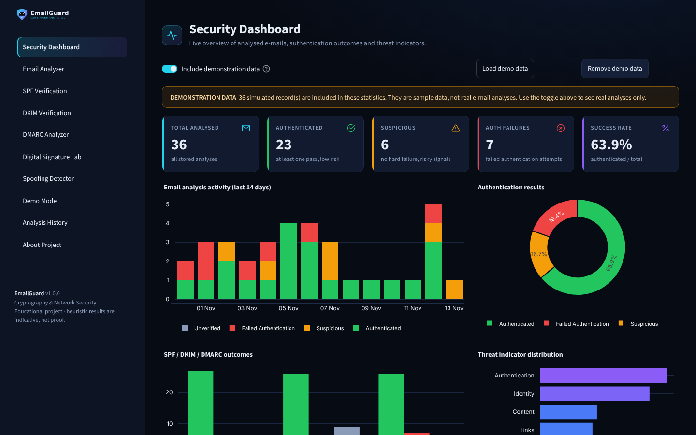
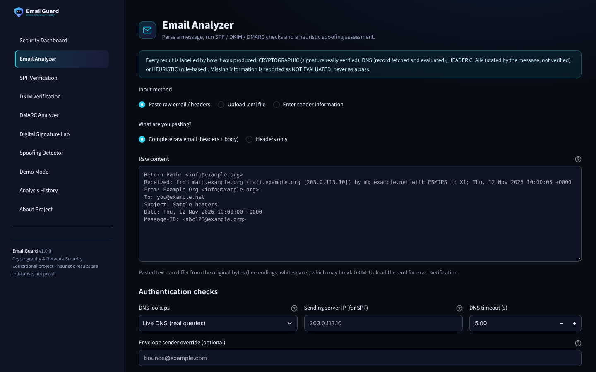

<div align="center">

# EmailGuard


### Intelligent Email Authentication and Spoofing Detection System

**Secure. Authenticate. Protect.**

</div>

A Streamlit-based email security application that analyzes email authentication, identifies suspicious indicators, and demonstrates cryptographic techniques.

<p>
  
  
  
  
</p>

</div>

---

## Overview

EmailGuard is an educational email authentication and spoofing detection system developed as a Cryptography and Network Security mini-project. It provides a single interface to inspect email messages, evaluate SPF, DKIM and DMARC authentication, identify suspicious email characteristics, and explore digital signatures.

The application accepts raw email content, email headers, and `.eml` files. It parses message information, performs available DNS-based and cryptographic checks, calculates a rule-based spoofing risk score, stores analysis history in SQLite, and generates PDF reports.

### Honesty and Verification

EmailGuard labels results according to how they were produced:

- **CRYPTOGRAPHIC** – a digital signature was actually verified.
- **DNS** – a DNS record was retrieved and evaluated.
- **HEADER CLAIM** – the message contains a claimed result; EmailGuard has not independently verified it.
- **HEURISTIC** – a rule-based assessment, not proof of malicious activity.
- **DEMONSTRATION** – simulated data used for educational scenarios.
- **NOT EVALUATED** – the required information was unavailable or the check could not be completed.

EmailGuard does not treat an email's own `Authentication-Results` header as independent proof, and it does not report a pass when it cannot establish one.

---

## Key Features

| Module | Description |
|---|---|
| **Security Dashboard** | Displays analysis KPIs, email activity, authentication outcomes, threat distribution, recent history and alerts. Demonstration records are clearly labelled. |
| **Email Analyzer** | Accepts pasted email headers or full messages, `.eml` uploads, and sender information. Extracts message fields and runs available authentication and spoofing checks. |
| **SPF Verification** | Retrieves SPF records through DNS and evaluates supported mechanisms against a supplied sending IP address. Displays the result and evaluation details. |
| **DKIM Verification** | Uses the `dkimpy` library to verify DKIM signatures with public keys retrieved from DNS. |
| **DMARC Analyzer** | Retrieves and parses DMARC records, explains policy tags, and evaluates SPF/DKIM alignment when the required results are available. |
| **Digital Signature Lab** | Demonstrates RSA-2048 key generation, SHA-256 hashing, RSA-PSS signing and verification, and message-tampering detection. |
| **Spoofing Detector** | Calculates a 0–100 heuristic risk score and explains the indicators contributing to the score. |
| **Demo Mode** | Provides five educational scenarios using a simulated DNS zone. Scenarios are labelled as demonstration data and can run offline. |
| **Analysis History** | Stores analyses in SQLite and supports searching, filtering, viewing, exporting and deleting records. |
| **PDF Reports** | Generates a report containing email details, authentication results, suspicious indicators, risk score and limitations. |
| **About Project** | Presents the project overview, objectives, technologies and application information. |

### Spoofing Risk Levels

| Score | Risk level |
|---:|---|
| 0–29 | LOW |
| 30–59 | MEDIUM |
| 60–100 | HIGH |

The risk score is heuristic. It is not a definitive determination that an email is malicious or legitimate.

---

## Technology Stack

| Category | Technologies |
|---|---|
| Programming language | Python 3.11+ |
| User interface | Streamlit, custom CSS |
| Charts and visualization | Plotly |
| Database | SQLite, Python `sqlite3` |
| Cryptography | `cryptography`, RSA-2048, RSA-PSS |
| Hashing | SHA-256, Python `hashlib` |
| DNS | dnspython |
| DKIM | dkimpy |
| Email parsing | Python `email` package |
| PDF generation | ReportLab |

---

## Application Screenshots

### Security Dashboard

The dashboard provides an overview of stored analyses, authentication outcomes, suspicious messages and activity trends. The screenshot below includes demonstration records.



### Email Analyzer

The Email Analyzer accepts email content and displays the final verdict, authentication information and heuristic risk assessment.



---

## System Architecture

```text
                         EmailGuard
                             |
                 +-----------+-----------+
                 |                       |
             User Input              Demo Scenarios
                 |                       |
                 +-----------+-----------+
                             |
                       Email Parser
                             |
                       Analysis Engine
                             |
          +------------------+------------------+
          |                  |                  |
      SPF Checker       DKIM Verifier      DMARC Analyzer
          |                  |                  |
          +------------------+------------------+
                             |
                    Spoofing Detector
                             |
                      Result Dictionary
                             |
             +---------------+---------------+
             |               |               |
          Streamlit        SQLite         PDF Report
          Interface        History        Generator
```

The analysis engine coordinates message parsing, authentication checks and heuristic analysis. DNS access is provided through resolver implementations, allowing live DNS checks and simulated DNS scenarios to use the same analysis flow.

---

## Project Structure

```text
EmailGuard/
│
├── app.py
├── config.py
├── requirements.txt
├── requirements-dev.txt
│
├── .streamlit/
│   └── config.toml
│
├── modules/
│   ├── email_parser.py
│   ├── dns_utils.py
│   ├── spf_checker.py
│   ├── dkim_verifier.py
│   ├── dmarc_checker.py
│   ├── rsa_signature.py
│   ├── hashing.py
│   ├── spoofing_detector.py
│   ├── analysis_engine.py
│   ├── demo_data.py
│   └── report_generator.py
│
├── database/
│   ├── schema.sql
│   └── db.py
│
├── pages/
│   └── ...
│
├── ui/
│   └── ...
│
├── assets/
│   ├── styles.css
│   ├── logo.png
│   └── icon.png
│
├── sample_emails/
│   └── demo_emails/
│
├── tools/
├── tests/
├── docs/
│   ├── project_documentation.md
│   └── screenshots/
│
└── README.md
```

---

## Installation and Setup

### Prerequisites

- Windows 10/11, Linux or macOS
- Python 3.11 or newer
- Internet connection for live DNS lookups

### 1. Clone the repository

```bash
git clone https://github.com/Kirankumar-K18/EmailGuard-CNS-Mini-Project.git
cd EmailGuard-CNS-Mini-Project
```

### 2. Create a virtual environment

**Windows PowerShell**

```powershell
python -m venv .venv
.\.venv\Scripts\Activate.ps1
```

If the `python` command is not available, try:

```powershell
py -3.11 -m venv .venv
.\.venv\Scripts\Activate.ps1
```

**Linux / macOS**

```bash
python3 -m venv .venv
source .venv/bin/activate
```

### 3. Install dependencies

```bash
python -m pip install --upgrade pip
python -m pip install -r requirements.txt
```

### 4. Run the application

```bash
python -m streamlit run app.py
```

Open the local address displayed in the terminal, usually:

```text
http://localhost:8501
```

The SQLite database is initialized by the application when it starts.

### Run tests

If the development requirements are included:

```bash
python -m pip install -r requirements-dev.txt
python -m pytest -q
```

---

## Demonstration Guide

The following sequence can be used to demonstrate the application:

1. **Security Dashboard** – load the demonstration records and explain the KPIs, charts and demonstration-data label.
2. **Demo Mode** – run the available scenarios and review the authentication results, method labels and suspicious indicators.
3. **Email Analyzer** – paste an email or upload an `.eml` file and inspect the parsing and analysis output.
4. **SPF Verification** – inspect SPF records and evaluate a supported record using a suitable sending IP address.
5. **DKIM Verification** – verify a signed email using its DKIM signature and DNS public key.
6. **DMARC Analyzer** – inspect the DMARC policy and alignment information.
7. **Digital Signature Lab** – generate an RSA key pair, sign a message, verify it, modify the message and verify again.
8. **Spoofing Detector** – review the risk score and the evidence behind each indicator.
9. **Analysis History** – search for an analysis, open its details and export records.
10. **PDF Report** – generate and review the report for an analyzed email.

For a real email, use the original `.eml` file when possible. Pasting or copying message content can change whitespace and line endings, which may affect DKIM verification.

---

## Sample Analysis Results

The following results were obtained while testing the application with synthetic email messages.

| Test case | Final verdict | Risk score | Observation |
|---|---|---:|---|
| Normal-looking sample email | UNVERIFIED | 20/100 – LOW | Header claims were not treated as verified results. SPF lacked a supplied sending IP and no DKIM signature was present. |
| Suspicious sender-mismatch sample | SUSPICIOUS | 38/100 – MEDIUM | Return-Path mismatch, urgency language, account-verification wording, missing DKIM signature, Message-ID domain mismatch and missing DMARC policy were identified. |

**Note:** These are application test results from synthetic messages. They are not measurements from a live email campaign or proof that a real sender is malicious. The example domains and IP addresses are reserved for documentation and testing.

---

## Important Notes and Limitations

- **Live DNS requires internet access.** Use Demo Mode for offline demonstrations.
- **SPF requires the delivering server's IP address.** EmailGuard needs an appropriate sending IP to evaluate SPF.
- **SPF implementation supports a documented subset of RFC 7208.** Unsupported mechanisms or macros are not guessed.
- **DKIM verification requires the original message bytes where possible.** Copying and pasting can alter whitespace or line endings.
- **DMARC evaluation depends on SPF/DKIM outcomes and domain alignment.** Missing information is reported as NOT EVALUATED.
- **Header authentication claims are not independently trusted.** `Authentication-Results` and `Received-SPF` values are reported as claims.
- **Organizational-domain detection uses a limited built-in suffix list**, not the complete Public Suffix List.
- **Spoofing scores are heuristic.** Legitimate emails may trigger indicators, and sophisticated attacks may avoid them.
- **RSA-PSS in the Digital Signature Lab is an educational demonstration.** It is separate from DKIM, which uses its own signing and canonicalization process.
- **Demo keys are for learning only.** Do not reuse demonstration private keys for real communication.
- **The application is designed as a local, single-user educational project.** The SQLite database is not encrypted by the application.

---

## Future Enhancements

- Full SPF macro and `ptr` mechanism support
- Public Suffix List integration
- DMARC aggregate report (`rua`) XML analysis
- Additional DKIM algorithm support
- S/MIME and PGP signature verification
- URL reputation and threat-intelligence integration
- IMAP mailbox integration
- User accounts and encrypted database storage
- Extended email attachment analysis

---

## Author

**Kirankumar K**

Computer Science and Data Science Engineering

RNS Institute of Technology

**GitHub:** https://github.com/Kirankumar-K18

**Repository:** https://github.com/Kirankumar-K18/EmailGuard.git

---

## License

This project is developed for educational and academic purposes.


---

<div align="center">

**EmailGuard – Secure. Authenticate. Protect.**

*An educational Cryptography and Network Security project.*

</div>
